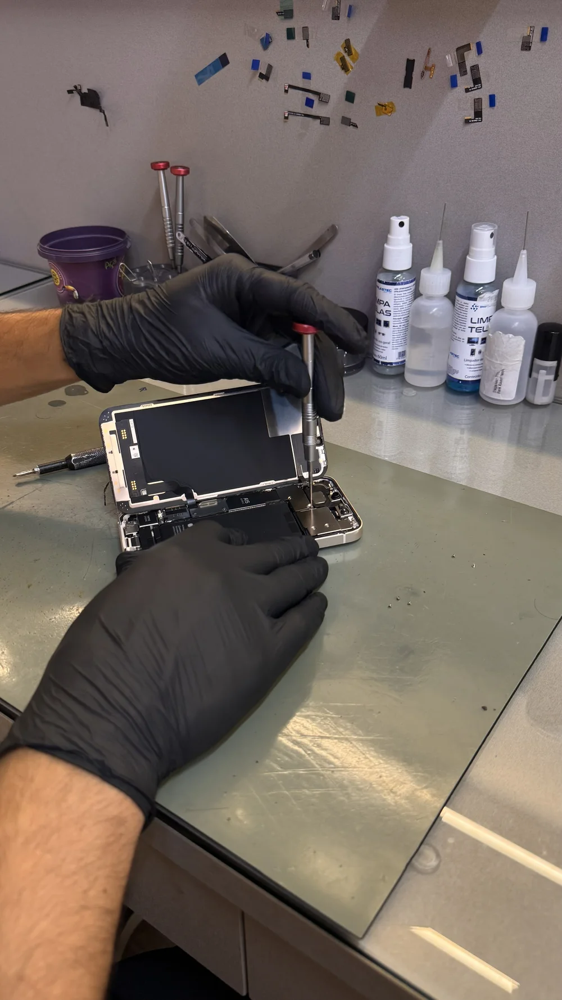

Quando o touch do celular não funciona, a tela pode continuar mostrando a hora, notificações ou animações. Ter imagem não significa que o sensor de toque esteja respondendo normalmente.

O primeiro passo é distinguir uma falha de toque de um aplicativo que parou de responder. Observe o que permanece funcionando e evite insistir em comandos ou senhas sem conseguir ver o resultado.

## A falha ocupa toda a tela ou só uma região?

Relate se o teclado deixa de reconhecer certas letras, se os botões de uma faixa não respondem ou se nenhum toque funciona. Informe também se a imagem continua se atualizando. Esses detalhes são mais úteis do que dizer apenas que o celular travou.

Se o problema ocorre somente em um aplicativo, registre qual é. Se a tela inteira fica congelada e o aparelho demora em várias tarefas, consulte também o guia de [celular travando muito](/2026/10/06/celular-travando-muito/).

## Verificações simples antes da avaliação

Com a tela íntegra e sem sinais de líquido ou deformação, confira se a superfície está limpa e seca. Observe se o problema começou após colocar uma capa ou película. Não arranque uma película aderida a vidro quebrado.

O Google recomenda verificar acessórios e reiniciar o dispositivo ao investigar [falhas na tela de um Android](https://support.google.com/android/answer/7666942?hl=pt-BR). A combinação de botões varia; siga o suporte do fabricante para o modelo. Não confunda reiniciar com restaurar de fábrica, que apaga dados.

Se o toque continua ausente, não force o vidro nem tente abrir o celular. A avaliação precisa considerar acessórios, sistema e componentes físicos.

## O vidro está inteiro. Ainda pode precisar de reparo?

A ausência de trinca não permite concluir que o problema é apenas um aplicativo. Informe quedas, pressão, umidade e reparos anteriores, mesmo que a parte externa pareça normal.

Por outro lado, toque sem resposta também não confirma que a tela precisa ser trocada. O diagnóstico evita escolher uma peça antes de entender a falha. Se houver rachaduras, leia os [riscos de continuar usando tela trincada](/2026/06/08/tela-trincada-do-celular-posso-continuar-usando-ou-devo-trocar/).

*Imagem do atendimento técnico; não identifica a causa da falha descrita neste artigo.*

## Como preparar o aparelho para atendimento

Se conseguir acessar os dados com segurança, confira o backup. Não forneça senhas de contas por mensagem; converse com a assistência sobre os testes necessários e o acesso ao aparelho. Não restaure o sistema apenas para tentar recuperar o toque sem antes verificar seus arquivos.

Informe marca, modelo, região afetada e quando a falha começou. Se o toque funciona de forma intermitente, um vídeo feito com outro celular pode ajudar a mostrar o comportamento.

## Perguntas frequentes

### Imagem normal significa que o touch está bom?

Não. A resposta ao toque e a exibição de imagem são funções diferentes e devem ser verificadas separadamente.

### Película pode atrapalhar a resposta?

Pode interferir em alguns casos. Relate se a falha começou após a instalação e siga as orientações do fabricante para avaliar o acessório.

### É preciso formatar o celular?

Não como primeira medida. A restauração pode apagar arquivos e não resolve danos físicos. Peça orientação antes de autorizar procedimentos que alterem seus dados.

## Avaliação de touch em Bombinhas

Consulte a ReeCell e explique se há imagem, trincas e resposta em alguma parte da tela. A página de [avaliação e troca de tela](/troca-de-tela-de-celular-em-bombinhas/) reúne as informações para iniciar o orçamento.
